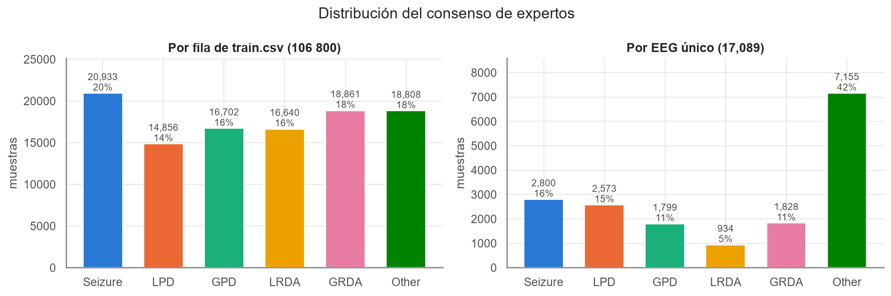
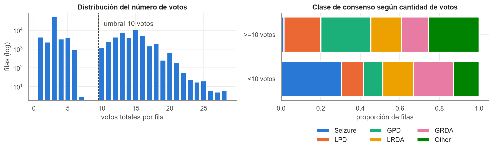
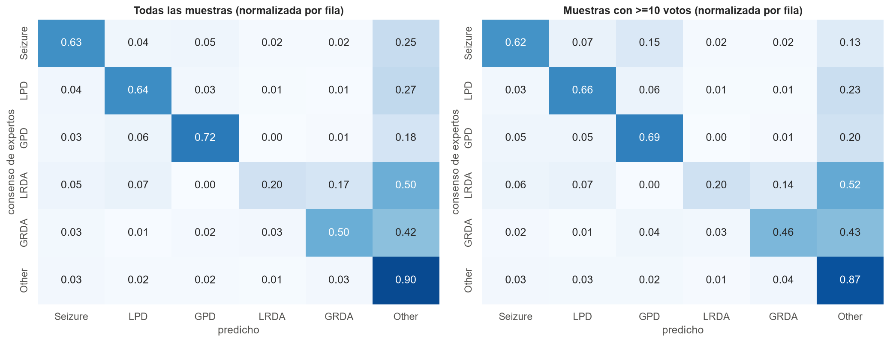
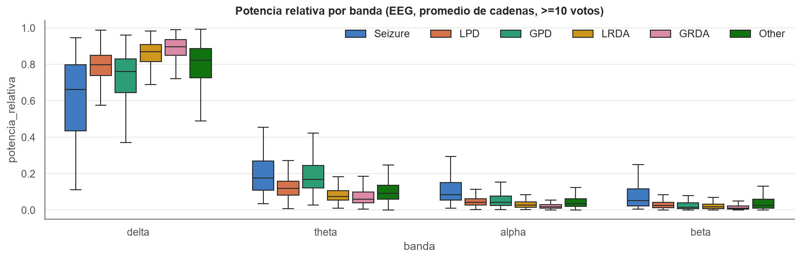

# Informe Final: Clasificación Multiclase de Patologías en Actividad Cerebral

**Curso:** Machine Learning - Maestría en Computación
**Institución:** Instituto Tecnológico de Costa Rica (TEC)
**Dataset:** HMS - Harmful Brain Activity Classification (Kaggle)
**Año:** 2026

**Autores:**
- Jordani Mejía Quirós (2018105537)
- Luis Fernando Solano Coto (2026800988)

**Fecha de entrega:** 12 de noviembre de 2026

---

## Resumen Ejecutivo

### Síntesis
El proyecto clasifica segmentos de EEG de pacientes en cuidados intensivos en seis patrones (Seizure, LPD, GPD, LRDA, GRDA y Other) a partir de los votos de especialistas del dataset HMS de Kaggle. Se aplicó CRISP-DM en **dos iteraciones independientes**, en las que la segunda parte de lo aprendido en la primera. La Iteración 1 construyó el protocolo contra la fuga de información (partición por paciente y holdout reservado) y una CNN pequeña entrenada desde cero, con Macro F1 de 0.384 en el fold 1. La Iteración 2 usó CNNs preentrenadas en ImageNet sobre imágenes que combinan los espectrogramas de Kaggle y espectrogramas calculados del EEG crudo, validadas con 5 folds agrupados por paciente. El modelo seleccionado es un ensamble EfficientNet-B0 + ConvNeXt-Tiny de dos cabezas con compuerta. Obtiene divergencia KL de 0.567, Macro F1 de 0.655, AUC-ROC macro de 0.923 y sensibilidad de 0.70 para *Seizure*. Con especificidades de 0.95 a 0.98 en las clases patológicas, su uso realista es la priorización de registros para revisión médica, no el diagnóstico autónomo.

### Contribuciones Principales
- **Banda delta dominante:** concentra el 78 % de la potencia relativa en promedio, y entre el 87 % y el 90 % en GRDA y LRDA. Lo que distingue a las clases es su combinación con la asimetría entre hemisferios (unas 4 veces mayor en LPD y LRDA que en GPD y GRDA) y con la actividad rápida y el *line-length* (mayores en *Seizure*).
- **Confusiones sistemáticas:** LRDA con GRDA y con *Other*; *Seizure* con LPD; y casi cualquier patrón con *Other*. Coinciden con los desacuerdos entre los propios expertos, y el error del modelo crece con el desacuerdo humano (KL 0.16 en casos unánimes frente a 0.48 cuando la mayoría tiene menos del 50 % de los votos).
- **Preentrenamiento:** con la misma arquitectura y el mismo fold, el preentrenamiento en ImageNet mejora la KL en ~0.095.
- **EEG crudo:** convertido a espectrograma, aporta más que los espectrogramas de Kaggle, y combinar ambos es lo mejor.
- **EEG con pocos votos:** los EEG de menos de 10 votos tienen otra distribución de clases (el 93.5 % de los EEG de *Seizure* está en ese grupo). Descartarlos baja el recall de *Seizure* de 0.62 a 0.45. Un solo modelo que aprende de ambos grupos supera a dos especialistas separados.
- **Interpretabilidad:** se basó en el análisis de errores, la comparación entre la confusión humana y la del modelo, la calibración y la revisión de los peores casos. No se calcularon valores SHAP (ver [Limitaciones](#4-limitaciones)).

### Resultados Clave
- **Métrica principal (Macro F1-Score)**: 0.655 (validación cruzada de 5 folds, 17 089 EEG)
- **Métrica clínica (AUC-ROC)**: 0.923 (macro, uno contra el resto)
- **Sensibilidad Seizure (crítica)**: 70.0 %
- **Modelo seleccionado**: ensamble EfficientNet-B0 + ConvNeXt-Tiny de dos cabezas con compuerta (Iteración 2, ciclo 2.3)
- **Mejora vs baseline**: +40 % en Macro F1 (0.467 → 0.655) y −36 % en divergencia KL (0.882 → 0.567) frente a gradient boosting sobre potencias por banda

---

## 1. Introducción

### 1.1 Contexto del Problema

- **Diagnóstico automático:** en las unidades de cuidados intensivos se registran horas de EEG continuo por paciente. Detectar a tiempo convulsiones y patrones del continuo ictal-interictal (descargas periódicas y actividad rítmica lenta) permite ajustar el tratamiento antes de que haya daño neurológico.
- **Interpretación manual:** la revisión la hace un neurofisiólogo, lo que es lento, costoso y poco escalable. Además, los expertos discrepan con frecuencia: en HMS solo una parte de los segmentos tiene acuerdo alto, y los desacuerdos se concentran entre clases vecinas (LPD↔GPD, LRDA↔GRDA, Seizure↔LPD).
- **Estado del arte:** las mejores soluciones de la competencia transforman el EEG en espectrogramas y usan CNNs de visión preentrenadas, con montaje bipolar, entrenamiento en dos etapas y validación agrupada por paciente ([Estado_del_Arte_HMS.md](Estado_del_Arte_HMS.md)).
- **Sensibilidad para convulsiones:** una convulsión no detectada tiene un costo clínico mucho mayor que una falsa alarma revisada por un médico. Por eso se reporta la sensibilidad por clase, además de las métricas globales.

### 1.2 Motivación

¿Por qué es importante este proyecto?

- **Impacto potencial:** una herramienta que ordene los registros por probabilidad de patología puede reducir el tiempo hasta la revisión de los casos urgentes.
- **Datos médicos reales:** HMS tiene más de 100 000 segmentos etiquetados por especialistas, con el ruido, los artefactos y el desacuerdo propios de la práctica clínica.
- **Representación de la señal:** el proyecto compara features clásicas por banda, espectrogramas de una banda y espectrogramas de alta resolución del EEG crudo.
- **Desbalance:** *Other* representa el 42 % de los EEG y LRDA el 5.5 %, y las clases raras son las de mayor interés clínico.

### 1.3 Objetivos
Los objetivos general y específicos están en [propuesta.md](propuesta.md), secciones 4 y 5. Durante el proyecto se agregó un objetivo metodológico: comparar dos acercamientos independientes (Iteraciones 1 y 2) bajo protocolos que eviten la fuga de información entre pacientes.

---

## 2. Revisión de Metodología CRISP-DM

El seguimiento detallado por fase está en [crispdm.md](crispdm.md). Las dos iteraciones son acercamientos independientes, con su propio código, partición y protocolo. Aun así, la Iteración 2 no parte de cero: incorpora los aprendizajes de la Iteración 1.

- **Protocolo contra la fuga de información:** conserva la partición agrupada por paciente, la comprobación de que no se comparten EEG ni espectrogramas entre entrenamiento y validación, y la normalización por imagen en lugar de un escalador global.
- **Objetivo probabilístico:** mantiene los seis votos como distribución objetivo, como en la Iteración 1, y lo lleva a la pérdida y a la métrica principal (KL).
- **Límites del modelo inicial:** el sobreajuste a la tercera época y la baja resolución de la entrada (64 × 64, una banda) motivaron imágenes de 512 × 512 con más fuentes de información y el uso de GPU.
- **Hipótesis pendiente:** la Iteración 1 dejó abierta la pregunta de si una CNN preentrenada supera a una entrenada desde cero. La Iteración 2 la responde con una comparación controlada (misma arquitectura, mismo fold).
- **Registro de validaciones consultadas:** se mantiene la práctica de documentar qué folds se usaron para decidir, para no reutilizarlos como evaluación.

| | Iteración 1 | Iteración 2 |
|---|---|---|
| Responsable principal | Jordani Mejía | Luis Fernando Solano |
| Aporte al proyecto | Protocolo, partición por paciente, objetivo probabilístico y diagnóstico de límites | Respuesta a la hipótesis del preentrenamiento y comparación de enfoques |
| Entrada | Espectrograma de Kaggle, 64 × 64, una banda | 4 espectrogramas de Kaggle + 4 del EEG crudo, 512 × 512 |
| Modelo | CNN pequeña desde cero (CPU) | CNNs preentrenadas (`timm`, GPU) con pérdida KL |
| Validación | Fold 1 de desarrollo; holdout de 390 pacientes reservado | 5 folds agrupados por paciente (predicciones fuera de fold) |
| Código | `notebooks/01`–`04`, `src/hms_cnn.py` | `notebooks/iteracion_2/`, resto de `src/` |

### 2.1 Fase 1: Business Understanding

El problema se definió como clasificación multiclase supervisada de seis patrones a partir de la distribución de votos de los expertos. Se priorizaron métricas balanceadas entre clases y métricas clínicas por clase ([propuesta.md](propuesta.md)). En la Iteración 2 se añadió como métrica principal la **divergencia KL** entre la distribución de votos y la predicha. Es la métrica oficial de la competencia y respeta que el objetivo sea una distribución y no una etiqueta.

**Conclusión de fase:**
- ✅ Problema bien definido: Clasificación multiclase de 6 categorías de patologías
- ✅ Objetivos claros: Sensibilidad clínica, interpretabilidad
- ✅ Métricas de éxito identificadas: Macro F1, AUC-ROC, Sensibilidad/Especificidad (y KL en la Iteración 2)
- ✅ Riesgos documentados: Desbalance, artefactos, generalización

### 2.2 Fase 2: Data Understanding

#### Descripción del Dataset

| Atributo | Detalle |
|----------|---------|
| **Fuente** | Kaggle HMS Competition |
| **Tamaño** | 106 800 ventanas etiquetadas de 17 089 EEG y 1 950 pacientes |
| **Features** | EEG de 19 electrodos + ECG a 200 Hz; espectrogramas de 10 min con 4 regiones × 100 frecuencias (0.59–19.92 Hz); 65 features de bandas derivadas (Iteración 2) |
| **Período temporal** | Ventanas de 50 s de EEG centradas en el segmento etiquetado; contexto de 10 min de espectrograma |
| **Granularidad** | Cada ventana tiene una distribución de votos sobre 6 clases; varias ventanas por EEG y varios EEG por paciente |
| **Clases objetivo** | 6 categorías: Seizure, LPD, GPD, LRDA, GRDA, Other |

#### Distribución de Clases



Clase de consenso por EEG (una muestra por `eeg_id`, 17 089 EEG): Other 41.9 %, Seizure 16.4 %, LPD 15.1 %, GRDA 10.7 %, GPD 10.5 %, LRDA 5.5 %.

- **Clase más frecuente**: Other - 41.9 %
- **Clase menos frecuente**: LRDA - 5.5 %
- **Desbalance**: 7.6 : 1 (Other frente a LRDA)
- **Problema**: Desbalanceado, y el desbalance cambia según la calidad de la etiqueta. Contadas por ventana (106 800 filas), las clases parecen casi equilibradas (14–20 % cada una) porque los EEG patológicos tienen más sub-ventanas. Entre los EEG de ≥10 votos *Seizure* es solo el ~1.5 %, frente al ~30 % entre los de <10 votos.

#### Variables Clave

Potencia relativa por banda del EEG crudo, en promedio de las 4 cadenas bipolares (17 089 EEG, ventana de 50 s, Welch, normalizada por la potencia entre 0.5 y 20 Hz):

| Variable | Tipo | Media | Desv. Est. | Notas |
|----------|------|-------|-----------|-------|
| Delta (0.5-4 Hz) | Float | 0.783 | 0.149 | Domina en GRDA/LRDA (87–90 % de la potencia, mediana en ≥10 votos) |
| Theta (4-8 Hz) | Float | 0.115 | 0.073 | Asociado con somnolencia y enlentecimiento |
| Alpha (8-13 Hz) | Float | 0.052 | 0.050 | Reposo, baseline normal |
| Beta (13-20 Hz) | Float | 0.051 | 0.086 | Actividad rápida; mayor en *Seizure* |
| Gamma (30-100 Hz) | — | — | — | No se usa: los espectrogramas de Kaggle llegan a 20 Hz y el EEG se filtra a 0.5–40 Hz |

Además de las bandas, el EDA identificó como discriminantes la asimetría entre hemisferios y el *line-length* (figura `results/figures/eda/asimetria_linelength.png`).

#### Valores Faltantes y Artefactos

- **Missing values**: 0 % en `train.csv`. En la señal, ~2.5 % de las ventanas de EEG tienen NaN y ~6 % de los espectrogramas de 10 min tienen tramos sin datos.
- **Artefactos detectados**: offset DC de −100 a −150 µV y ~30 % de ventanas con amplitud p99 > 500 µV (artefactos musculares o de electrodo).
- **Estrategia de tratamiento**: imputación de NaN, filtro Butterworth de 0.5–40 Hz, recorte a ±1024 µV y montaje bipolar doble banana; enmascarado de tiempo y frecuencia durante el entrenamiento para dar robustez a tramos faltantes.

#### Análisis Exploratorio de Tiempo



- **Rango temporal**: cada EEG aporta en promedio ~6 sub-ventanas de 50 s solapadas; el espectrograma cubre 10 min alrededor del segmento.
- **Redundancia entre sub-ventanas**: el 89 % de los EEG tiene exactamente el mismo patrón de votos en todas sus sub-ventanas, así que contarlas por separado sobrerrepresenta los EEG largos.
- **Concentración por paciente**: el 44 % de los pacientes es monoclase y el 1 % de los pacientes concentra el 19 % de las filas.
- **Evidencia de degradación temporal**: no aplica. El problema clasifica una ventana ya observada y no pronostica instantes futuros (punto 6 del protocolo en [crispdm.md](crispdm.md)).

**Conclusión de fase:**
- Dataset adecuado para objetivos propuestos
- Características espectrales y de lateralidad significativas identificadas
- Preparado para preprocessing, con la unidad de muestra y la partición definidas por los hallazgos de redundancia y concentración por paciente

### 2.3 Fase 3: Data Preparation

#### Limpieza de Datos

**Valores faltantes:**
- Métodos aplicados: imputación de NaN en la ventana de EEG antes del filtrado; los tramos sin datos del espectrograma se tratan como ceros tras la estandarización.
- Datos eliminados: 0 filas por calidad. En la Iteración 2 las 106 800 ventanas se consolidan en 17 089 muestras, una por EEG (sub-ventana central y objetivo igual a la media de las distribuciones de votos).
- Datos imputados: ~2.5 % de las ventanas de EEG contienen algún NaN.

**Outliers:**
- Método de detección: percentiles de amplitud por ventana (p99 > 500 µV).
- Outliers identificados: ~30 % de las ventanas.
- Tratamiento: Retención con recorte a ±1024 µV. Se conservan porque en ICU los artefactos son parte del problema real.

#### Transformaciones

**Variables numéricas:**
- Normalización: logaritmo y estandarización **por imagen** (Iteraciones 1 y 2). No se ajusta un escalador global con todo el conjunto, para evitar fuga entre folds. Para los baselines, StandardScaler dentro del pipeline de cada fold.
- Escalado: Iteración 1, reescalado a 64 × 64. Iteración 2, mosaico de 512 × 512 formado por 8 espectrogramas.

**Variables categóricas:**
- Codificación: no se usa OneHotEncoder ni LabelEncoder sobre el objetivo. Se modela la distribución de votos (6 probabilidades) con pérdida KL. La etiqueta dura (argmax) solo se usa para calcular accuracy, F1 y la matriz de confusión.
- Categorías creadas: indicador de calidad de etiqueta (≥10 o <10 votos), usado para el entrenamiento en dos etapas y para el modelo de dos cabezas.

#### Feature Engineering

**Features Estáticos (Baseline):**

65 features usadas por la regresión logística y el gradient boosting (`src/features.py`):

| Feature | Descripción | Fórmula |
|---------|-------------|---------|
| Potencia relativa por banda (Kaggle) | Media y desviación de la potencia relativa en cada región (LL, RL, LP, RP) y banda | `mean/std_t(Σ_f∈banda S(t,f) / Σ_f S(t,f))` |
| Potencia total por región | Logaritmo de la potencia media del espectrograma | `log(mean_t Σ_f S(t,f))` |
| Potencia relativa por banda (EEG) | Densidad espectral de Welch por cadena bipolar | `Σ_f∈banda P(f) / Σ_0.5≤f<20 P(f)` |
| Amplitud y *line-length* | Desviación estándar y longitud de línea por cadena | `std(x)`, `mean|x_t − x_t−1|` |
| Asimetría izquierda-derecha | Diferencia de log-potencia entre hemisferios | `(LL + LP) − (RL + RP)` |

**Features espectrales de alta resolución (entrada de las CNNs):**

| Feature | Descripción | Fórmula |
|---------|-------------|---------|
| Espectrograma Kaggle | 4 regiones, 10 min, 0.59–19.92 Hz | `log(S)` estandarizado por imagen |
| Espectrograma del EEG crudo | STFT de 50 s por cadena bipolar (LL, LP, RL, RP) | `log|STFT(x)|²` estandarizado |
| Mosaico de entrada | 8 espectrogramas en una imagen de 512 × 512, un canal | concatenación espacial |
| Aumentos | Intercambio de hemisferios y enmascarado tiempo/frecuencia | `p_swap`, `n_masks`, `mask_frac` |

**Features de Grafos (Dinámicos):**

No se implementaron. La relación espacial entre electrodos se representa con el montaje bipolar y con la asimetría entre hemisferios.

#### Dataset Final

**Train set (por fold, Iteración 2):**
- Muestras: ~13 670 EEG (4 de los 5 folds)
- Features: mosaico de 512 × 512 (CNNs) o 65 features (baselines)
- Distribución de clases: igual a la global (Other 41.9 % … LRDA 5.5 %), gracias a `StratifiedGroupKFold`

**Test set (por fold, Iteración 2):**
- Muestras: 3 417–3 418 EEG; las predicciones fuera de fold cubren los 17 089 EEG
- Features: las mismas
- Distribución de clases: igual a la global

En la Iteración 1 se usaron 67 305 filas de entrenamiento y 16 826 de validación (fold 1), con un holdout de 390 pacientes que no participó en ninguna decisión.

**Estrategia de split:**
- Método: `StratifiedGroupKFold` de 5 folds agrupados por paciente (semilla 42), sin pacientes, EEG ni espectrogramas compartidos entre entrenamiento y validación.
- Razón: un paciente aporta muchos segmentos casi idénticos y el 44 % de los pacientes es monoclase. Una división aleatoria por fila dejaría que el modelo reconozca al paciente e inflaría las métricas.

**Conclusión de fase:**
- ✅ Dataset limpio y validado
- ✅ Features espectrales y de lateralidad que capturan las firmas por clase
- ✅ Listo para modelado

### 2.4 Fase 4: Modeling

#### Enfoques Evaluados

**Enfoque 1: Estático (Baseline)**

Modelo: regresión logística y HistGradientBoosting sobre las 65 features de bandas (`src/baselines.py`)
```python
"logreg_bandas": make_pipeline(StandardScaler(), LogisticRegression(C=0.5, max_iter=2000)),
"hgb_bandas": HistGradientBoostingClassifier(max_iter=300, learning_rate=0.05,
                                             max_leaf_nodes=31, l2_regularization=1.0),
```

**Parámetros:**
- Regresión logística: C = 0.5
- HistGradientBoosting: 300 iteraciones, learning rate 0.05, 31 hojas, L2 = 1.0

**Resultados en Train:** no se registraron métricas de entrenamiento. Todas las cifras son predicciones fuera de fold.

**Resultados en Test (5 folds, 17 089 EEG):**
- Accuracy: 49.9 % (logística) · 56.9 % (gradient boosting)
- Macro F1: 0.354 · 0.467
- AUC-ROC: 0.756 · 0.835
- KL: 1.061 · 0.882

**Análisis:**
- Las features de bandas separan bastante mejor que los priors (KL 1.263), pero se quedan lejos de las CNNs. El gradient boosting supera a la regresión logística en los 5 folds.

---

**Enfoque 2: CNN entrenada desde cero (Iteración 1)**

Modelo: `SpectrogramCNN` (`src/hms_cnn.py`), 3 bloques convolucionales y una capa lineal
```python
nn.Conv2d(1, 16, 3, padding=1), nn.BatchNorm2d(16), nn.ReLU(), nn.MaxPool2d(2),
nn.Conv2d(16, 32, 3, padding=1), nn.BatchNorm2d(32), nn.ReLU(), nn.MaxPool2d(2),
nn.Conv2d(32, 64, 3, padding=1), nn.ReLU(), nn.AdaptiveAvgPool2d(1),
nn.Linear(64, 6)
```

**Parámetros:**
- Entrada: espectrograma de Kaggle de 50 s, una banda, 64 × 64
- Épocas: 3, fijadas antes de la corrida; lote de 64; CPU

**Resultados en Test (fold 1, 16 826 ventanas):**
- Accuracy: 39.1 % (clase mayoritaria: 19.9 %)
- Macro F1: 0.384 (clase mayoritaria: 0.055)
- Recall por clase: Seizure 0.41, LPD 0.29, GPD 0.20, LRDA 0.52, GRDA 0.51, Other 0.40

**Mejora vs Baseline:** supera ampliamente a la clase mayoritaria. No es directamente comparable con el Enfoque 1, que usa otra partición y otra unidad de muestra.

**Análisis:**
- La pérdida de validación baja hasta la época 2 y sube en la 3, señal de sobreajuste. Se reporta la época 3 porque estaba fijada de antemano.
- La resolución de 64 × 64 y una sola banda limitan la información disponible; esto motivó la Iteración 2.

---

**Enfoque 3: CNNs preentrenadas (Iteración 2)**

Modelo: CNNs de `timm` con pesos de ImageNet, pérdida KL y entrenamiento en dos etapas. Primero se entrena con todos los EEG y luego se afina con los de ≥10 votos. El modelo final del ciclo 2.3 tiene **dos cabezas** (una para alta y otra para baja calidad de etiqueta) y una **compuerta** que estima a qué grupo pertenece cada caso y mezcla ambas salidas (`src/mixed.py`).
```python
model = timm.create_model(arch, pretrained=True, num_classes=2 * 6 + 1, in_chans=1)
p_alta, p_baja = softmax(z[:, :6]), softmax(z[:, 6:12])
g = sigmoid(z[:, 12])                       # P(EEG de baja calidad)
pred = g * p_baja + (1 - g) * p_alta
```

Resultados por arquitectura en el fold 0, todas con la misma partición y el mismo presupuesto:

| Modelo | KL | KL ≥10 votos | AUC macro | Tiempo (min) |
|---|---|---|---|---|
| EfficientNet-B2 | 0.646 | 0.349 | 0.907 | 19 |
| EfficientNet-B0 | 0.648 | 0.351 | 0.909 | 13 |
| RegNetY-016 | 0.655 | 0.351 | 0.907 | 20 |
| ConvNeXt-Tiny | 0.655 | 0.368 | 0.908 | 22 |
| ResNet34 | 0.717 | 0.438 | 0.888 | 10 |
| EfficientNet-B0 sin preentrenar | 0.743 | 0.394 | 0.886 | 14 |

Se eligieron EfficientNet-B0 y ConvNeXt-Tiny para el ensamble porque son de familias distintas y fueron el mejor par en el fold 0 (KL 0.602).

#### Hyperparameter Tuning

Modelo seleccionado: EfficientNet-B0 y ConvNeXt-Tiny (por separado), y después los pesos del ensamble

**Estrategia:** optimización bayesiana con Optuna (TPE con poda): 30 intentos para EfficientNet-B0 y 20 para ConvNeXt-T, sobre el fold 0, minimizando la KL macro. Los pesos, el tipo de promedio y la temperatura del ensamble se optimizaron de forma anidada: lo que se aplica a un fold se ajusta solo con los otros cuatro.

**Parámetros testeados** (`src/hq.py`):
```
espacio = {
    'lr': log-uniforme (rango por arquitectura),
    'weight_decay': [1e-4, 1e-1] log,
    'epochs': [6, 20],
    'batch_size': [16, 32],
    'drop_rate': [0, 0.5],  'drop_path_rate': [0, 0.3],
    'swap_p': [0, 0.5],  'n_masks': [0, 3],  'mask_frac': [0, 0.25],
    'mixup': [0, 0.4],  'class_weight': [0, 1],
    'lq_weight': peso de los EEG de <10 votos (ciclo 2.3)
}
```

**Mejores parámetros encontrados (modelo final):**
- EfficientNet-B0: lr 1.0e-3, 12 épocas, lote 16, 3 máscaras de 27 %, `class_weight` 0.18, `lq_weight` 0.087
- ConvNeXt-Tiny: lr 1.1e-4, 14 épocas, lote 32, 3 máscaras de 21 %, `class_weight` 0.84, `lq_weight` 0.3

**Mejora vs parámetros default:** en el fold 0, la KL macro pasó de 0.491 a 0.420 (EfficientNet-B0, −14 %) y de 0.520 a 0.478 (ConvNeXt-T, −8 %). El hiperparámetro más influyente en ambos fue el tamaño de las máscaras de aumento.

#### Validación Cruzada

**Estrategia:** StratifiedGroupKFold (k=5) agrupado por paciente

**Resultados (modelo final, predicciones fuera de fold):**
```
Fold 1: AUC-ROC = 90.9%   Macro F1 = 0.647   KL = 0.608
Fold 2: AUC-ROC = 93.6%   Macro F1 = 0.665   KL = 0.560
Fold 3: AUC-ROC = 92.6%   Macro F1 = 0.657   KL = 0.549
Fold 4: AUC-ROC = 92.3%   Macro F1 = 0.649   KL = 0.567
Fold 5: AUC-ROC = 92.4%   Macro F1 = 0.653   KL = 0.551

Promedio: 92.3% ± 0.9%
```

El fold 1 (fold 0 en el código) es el más difícil y además el que se usó para optimizar los hiperparámetros, así que no favorece al modelo.

**Conclusión de fase:**
- ✅ Modelos entrenados y validados
- ✅ Hiperparámetros optimizados
- ✅ Mejor modelo identificado: ensamble EfficientNet-B0 + ConvNeXt-Tiny de dos cabezas con compuerta

### 2.5 Fase 5: Evaluation

#### Comparación de Modelos

Iteración 2, validación cruzada de 5 folds sobre los 17 089 EEG. La KL reemplaza a las columnas NDCG de la plantilla, que no aplican a este problema.

| Modelo | Accuracy | Macro F1 | AUC-ROC | KL | KL ≥10 votos | Tiempo (min) |
|--------|----------|----------|---------|----|--------------|-----------|
| Prior de clases | 41.9 % | 0.098 | 0.500 | 1.263 | 0.909 | — |
| Regresión logística (bandas) | 49.9 % | 0.354 | 0.756 | 1.061 | 0.814 | — |
| Gradient boosting (bandas) | 56.9 % | 0.467 | 0.835 | 0.882 | 0.656 | — |
| Ciclo 2.1: ensamble 50/50 | 71.7 % | 0.633 | 0.924 | 0.576 | 0.347 | 311 |
| Ciclo 2.2: solo ≥10 votos, optimizado | 66.8 % | 0.567 | 0.901 | 0.701 | 0.342 | — |
| Ciclo 2.3: modelo único optimizado | 72.1 % | 0.645 | 0.922 | 0.569 | 0.348 | 171 |
| **Ciclo 2.3: dos cabezas + compuerta** | **72.2 %** | **0.655** | **0.923** | **0.567** | 0.377 | 171 |

Los tiempos son de entrenamiento de los 5 folds en una RTX 4070 Ti SUPER. Como referencia, la Iteración 1 alcanzó Macro F1 de 0.384 en su fold 1. Es otro acercamiento, con otra partición y otra unidad de muestra.

**Modelo seleccionado:** ensamble EfficientNet-B0 + ConvNeXt-Tiny de dos cabezas con compuerta
**Justificación:** es el modelo con mejor KL global, mejor Macro F1 y mejor KL macro en los EEG de pocos votos (0.755), y tiene el mayor recall mínimo por clase. En los EEG de ≥10 votos el modelo único optimizado tiene menor KL macro (0.388 frente a 0.399), pero la diferencia es pequeña y el modelo de dos cabezas sube la sensibilidad de *Seizure* y de LRDA.

#### Matriz de Confusión



Modelo final (filas = clase de consenso de los expertos, columnas = predicción):

| Real \ Predicción | Seizure | LPD | GPD | LRDA | GRDA | Other |
|---|---:|---:|---:|---:|---:|---:|
| Seizure | 1 959 | 112 | 141 | 71 | 68 | 449 |
| LPD | 149 | 1 763 | 118 | 40 | 20 | 483 |
| GPD | 71 | 92 | 1 396 | 6 | 37 | 197 |
| LRDA | 79 | 104 | 3 | 278 | 197 | 273 |
| GRDA | 68 | 19 | 96 | 91 | 1 126 | 428 |
| Other | 336 | 187 | 196 | 199 | 418 | 5 819 |

La figura corresponde al ensamble del ciclo 2.1; la tabla, al modelo final.

**Interpretación:**
- **Clases mejor predichas:** GPD (sensibilidad 0.78, AUC 0.96) y LPD (0.69, AUC 0.95). Las descargas periódicas tienen una firma visual clara en el espectrograma.
- **Clases frecuentemente confundidas:** LRDA con GRDA (21 %) y con *Other* (29 %); GRDA con *Other* (23 %); *Seizure* con *Other* (16 %).
- **Tasa de error por clase** (1 − sensibilidad): Seizure 30 %, LPD 31 %, GPD 22 %, LRDA 70 %, GRDA 38 %, Other 19 %.

| Clase | Soporte | Sensibilidad | Especificidad | Precisión | AUC |
|---|---|---|---|---|---|
| Seizure | 2 800 | 0.700 | 0.951 | 0.736 | 0.935 |
| LPD | 2 573 | 0.685 | 0.965 | 0.774 | 0.947 |
| GPD | 1 799 | 0.776 | 0.964 | 0.716 | 0.962 |
| LRDA | 934 | 0.298 | 0.975 | 0.406 | 0.883 |
| GRDA | 1 828 | 0.616 | 0.952 | 0.603 | 0.913 |
| Other | 7 155 | 0.813 | 0.816 | 0.761 | 0.900 |

#### Feature Importance



No se calculó la importancia de features del modelo final, porque las CNNs trabajan directamente sobre el mosaico de espectrogramas. Las ablaciones de la entrada en el fold 0 cumplen un papel parecido, porque miden cuánto aporta cada fuente de información:

1. Espectrogramas del EEG crudo: quitarlos sube la KL de 0.648 a 0.751 (+16 %)
2. Preentrenamiento en ImageNet: quitarlo sube la KL a 0.743 (+15 %)
3. Espectrogramas de Kaggle: quitarlos sube la KL a 0.689 (+6 %)
4. Afinado en ≥10 votos (etapa 2): sin él, la KL ≥10 votos sube de 0.351 a 0.459 (+31 %)
5. Tamaño de las máscaras de aumento: el hiperparámetro de mayor importancia en Optuna (`results/figures/optimizacion/importancia_hiperparametros.png`)

**Insight:** la información útil está en la frecuencia, la periodicidad y la lateralidad. Los espectrogramas del EEG crudo, más finos y de 50 s, son la fuente más valiosa, y el contexto de 10 min de Kaggle aporta información complementaria.

#### SHAP Values (Explicabilidad)

No se calcularon valores SHAP. En su lugar:

- **Comparación de confusiones** (`results/figures/evaluacion/humano_vs_modelo.png`): el modelo confunde los mismos pares de clases que los expertos.
- **Calibración** (`results/figures/evaluacion/calibracion.png`): *Other* está sobrepredicha en el ciclo 2.1; el modelo final corrige ese sesgo (predice *Other* en el 45 % de los casos, frente al 42 % real).
- **Peores casos** (`results/figures/evaluacion/peores_casos.png`): EEG de GPD y LPD con alto acuerdo y descargas visibles, clasificados como *Other* con más de 80 % de confianza. Son fallos reales del modelo, no ruido de etiqueta.

#### Análisis de Errores

**Errores principales:**
1. Error: patrón patológico → *Other*
   - Frecuencia: 1 830 de 9 934 EEG patológicos (18 %)
   - Causa probable: *Other* es la clase mayoritaria y los expertos también le asignan parte de sus votos en los casos dudosos (0.26 en LRDA, 0.28 en GRDA).
   - Impacto: es el error clínicamente más costoso, porque un patrón no detectado no se prioriza para revisión.

2. Error: LRDA ↔ GRDA
   - Frecuencia: 21 % de los LRDA se predicen como GRDA y 5 % de los GRDA como LRDA
   - Causa probable: ambas son actividad delta rítmica y difieren solo en la lateralidad; LRDA es la clase más rara (934 EEG).
   - Impacto: menor que el anterior, porque ambas son patrones del continuo ictal-interictal y el registro llega igualmente a revisión.

3. Error: alto error en casos de desacuerdo humano
   - Frecuencia: la KL es 0.16 en casos unánimes y 0.48 cuando la clase mayoritaria tiene <50 % de los votos.
   - Causa probable: incertidumbre inherente a la etiqueta.
   - Impacto: parte del error no es reducible con el modelo.

#### Validación de Hipótesis

Se evalúan las hipótesis de [propuesta.md](propuesta.md) (sección 6) y las de [crispdm.md](crispdm.md). Las hipótesis H1–H3 que traía la plantilla (time-decay, grafos, vida media) no aplican a este proyecto.

**H1: Modelo de gradient boosting > Logistic Regression en AUC-ROC ≥ 5 %**
- Resultado: ✅ Confirmada (con HistGradientBoosting en lugar de XGBoost)
- Diferencia: AUC 0.835 frente a 0.756 (+10.4 %); gana en los 5 folds
- Significancia estadística: t-test pareado sobre los 5 folds, p = 0.0006
- Conclusión: las features de bandas tienen relaciones no lineales que la regresión logística no captura; aun así, ambos quedan muy por debajo de las CNNs.

**H2: Con manejo de desbalance, Macro F1-Score ≥ 0.65**
- Resultado: ✅ Confirmada, por poco margen
- Conclusión: el modelo final alcanza Macro F1 de 0.655 con ponderación de clases (`class_weight`) y de calidad de etiqueta (`lq_weight`) optimizadas. El ensamble del ciclo 2.1, sin ponderación, quedó en 0.633. La mejora viene sobre todo de LRDA y GRDA.

**H3: Las características más importantes se concentran en bandas delta-theta**
- Resultado: ⚠️ Parcialmente
- Conclusión: delta concentra el 78 % de la potencia y distingue GRDA y LRDA. Pero LPD y LRDA se separan de GPD y GRDA por la asimetría entre hemisferios, y *Seizure* por la actividad rápida (beta) y el *line-length*. Las bandas bajas no bastan por sí solas.

**H (Iteración 1): una CNN preentrenada supera a la entrenada desde cero**
- Resultado: ✅ Confirmada en la Iteración 2. Con EfficientNet-B0 y el mismo fold, la KL baja de 0.743 a 0.648.

**Conclusión de fase:**
- ✅ Evaluación completa
- ✅ Hipótesis testeadas
- ✅ Modelo final seleccionado

### 2.6 Fase 6: Deployment

#### Modelo Final

**Nombre:** HMS-dual-ensemble (EfficientNet-B0 + ConvNeXt-Tiny, dos cabezas con compuerta)
**Versión:** 1.0
**Fecha:** 2026-11-09

**Parámetros finales:**
```
entrada:       mosaico 512 × 512, 1 canal (4 espectrogramas Kaggle + 4 del EEG crudo)
backbones:     efficientnet_b0.ra_in1k, convnext_tiny.fb_in22k_ft_in1k (timm, ImageNet)
salida:        2 × 6 probabilidades (alta / baja calidad) + compuerta sigmoide
pérdida:       KL sobre la distribución de votos; peso de compuerta 0.3
optimizador:   AdamW, calentamiento + coseno, bf16
ensamble:      promedio (aritmético o geométrico) con peso y temperatura anidados por fold
semilla:       42
```

**Performance:**
- AUC-ROC: 92.3 %
- Macro F1: 0.655
- KL: 0.567 (0.377 en EEG de ≥10 votos)

No se hizo un despliegue en producción. `src/predict.py` genera las predicciones sobre `test.csv` en el formato de envío de Kaggle.

#### Reproducibilidad

✅ **Checklist de reproducibilidad:**
- [x] Código modular en `src/`
- [x] Notebooks ejecutables de principio a fin
- [x] Seeds fijos para reproducibilidad
- [x] `requirements.txt` con versiones mínimas
- [x] Instrucciones de setup en `README.md`
- [x] Documentación CRISP-DM completa

**Cómo reproducir el proyecto:**
```bash
# 1. Clonar y setup
git clone https://github.com/Jormq99/proyecto-ml-grupo-06.git
pip install -r requirements.txt     # torch con CUDA: ver nota en requirements.txt

# 2. Descargar datos (Kaggle: hms-harmful-brain-activity-classification)
#    y apuntar las variables HMS_DATA_DIR y HMS_WORK_DIR (ver data/README.md)

# 3a. Iteración 1
jupyter nbconvert --to notebook --execute notebooks/01_exploracion.ipynb
jupyter nbconvert --to notebook --execute notebooks/02_preprocesamiento.ipynb
jupyter nbconvert --to notebook --execute notebooks/03_modelado.ipynb
jupyter nbconvert --to notebook --execute notebooks/04_evaluacion.ipynb

# 3b. Iteración 2 (GPU)
python -m src.build_cache
bash run_experiments.sh screening
bash run_experiments.sh cv effb0 efficientnet_b0.ra_in1k 1e-3
bash run_experiments.sh cv convnext_t convnext_tiny.fb_in22k_ft_in1k 2e-4 2
bash run_hq.sh
bash run_mixed.sh

# 4. Predicciones sobre test.csv
python -m src.predict --models cv_effb0:efficientnet_b0.ra_in1k cv_convnext_t:convnext_tiny.fb_in22k_ft_in1k
```

---

## 3. Conclusiones

### 3.1 Hallazgos Principales

1. **Hallazgo 1: el preentrenamiento y la representación pesan más que la arquitectura.** Con ImageNet y espectrogramas de alta resolución del EEG crudo, la Macro F1 pasa de 0.38 (CNN pequeña desde cero) a 0.63–0.65. Entre arquitecturas preentrenadas, las diferencias de KL son menores a 0.01.
2. **Hallazgo 2: la calidad de la etiqueta cambia el problema.** Los EEG de <10 votos tienen otra distribución de clases y otra apariencia por clase. Descartarlos daña la detección de *Seizure*; un modelo único con una cabeza por grupo aprovecha ambos.
3. **Hallazgo 3: el error del modelo sigue al desacuerdo humano.** Las confusiones del modelo son las mismas que las de los expertos, y la mayor parte del error está en los casos ambiguos. LRDA sigue siendo la clase más débil (sensibilidad 0.30).

### 3.2 Respuesta a Preguntas de Investigación

**Pregunta principal:** ¿Es posible entrenar un modelo de Machine Learning que clasifique automáticamente patologías cerebrales en registros EEG con desempeño comparable o superior al baseline?

**Respuesta:** Sí. El modelo final supera con amplitud a los baselines y a la CNN desde cero de la Iteración 1. Su desempeño es comparable al de las soluciones de referencia de la competencia en AUC (0.923, frente a 0.91–0.925 según [Estado_del_Arte_HMS.md](Estado_del_Arte_HMS.md)), aunque su KL no es directamente comparable con el leaderboard, cuyo test solo tenía EEG de alto acuerdo.

**Evidencia:** KL 0.567 frente a 0.882 del gradient boosting; Macro F1 0.655 frente a 0.467; AUC 0.923 ± 0.009 en 5 folds agrupados por paciente.

### 3.3 Impacto y Aplicabilidad

- **Impacto académico:** muestra en un caso real cómo la unidad de muestra, la partición por paciente y la calidad de la etiqueta cambian las conclusiones. También documenta dos acercamientos comparables al mismo problema.
- **Impacto práctico para la práctica clínica:** con especificidades de 0.95 a 0.98 en las clases patológicas, el modelo sirve para ordenar registros por urgencia y reducir el tiempo hasta la revisión médica. No sustituye el diagnóstico: un 30 % de las convulsiones no se detectan como tales.
- **Transferibilidad a otros dominios:** convertir señales a espectrogramas y usar CNNs preentrenadas se aplica a otras señales biomédicas (ECG, EMG) y a audio. El modelado de la calidad de la etiqueta sirve en cualquier problema con anotadores múltiples.

---

## 4. Limitaciones

1. **Limitación 1:** optimización de hiperparámetros solo en el fold 0 y con una semilla por experimento.
   - Impacto: las diferencias menores a 0.01 de KL entre arquitecturas o estrategias no son concluyentes.
   - Estrategia de mitigación: repetir los mejores candidatos con varias semillas y optimizar en más folds.

2. **Limitación 2:** sin evaluación en un conjunto externo.
   - Impacto: la Iteración 2 valida con predicciones fuera de fold y no usa el holdout de la Iteración 1 para decidir. Como referencia descriptiva, sobre los 390 pacientes de ese holdout el ensamble del ciclo 2.1 obtiene KL 0.514 y Macro F1 0.677, pero no es una evaluación ciega del modelo final.
   - Estrategia de mitigación: congelar el modelo y evaluarlo una única vez en el test oculto de Kaggle o en otro hospital.

3. **Limitación 3:** LRDA y *Seizure* de alta calidad tienen pocos ejemplos (934 y 182 EEG).
   - Impacto: sensibilidad de LRDA de 0.30 y precisión baja de *Seizure* en alta calidad.
   - Estrategia de mitigación: sobremuestreo de LRDA y pseudo-etiquetado de los EEG de pocos votos.

4. **Limitación 4:** no se calcularon SHAP ni la importancia de features del modelo final.
   - Impacto: la explicabilidad se apoya en ablaciones y análisis de errores, no en explicaciones por caso.
   - Estrategia de mitigación: mapas de activación (Grad-CAM) sobre el mosaico de espectrogramas.

5. **Limitación 5:** las dos iteraciones usan particiones y unidades de muestra distintas.
   - Impacto: la comparación entre iteraciones es entre enfoques, no un experimento controlado.
   - Estrategia de mitigación: evaluar ambos modelos sobre el mismo holdout de pacientes.

---

## 5. Trabajo Futuro

### 5.1 Mejoras Técnicas

1. **Modelos 1D sobre el EEG crudo**
   - Descripción: CNNs 1D o modelos tipo WaveNet sobre la señal bipolar, para diversificar el ensamble.
   - Beneficio esperado: errores menos correlacionados con los de las CNNs 2D.

2. **Más contexto temporal**
   - Descripción: ventanas de 10–20 s a mayor resolución, o varias escalas de tiempo en la misma imagen.
   - Beneficio esperado: mejor detección de patrones periódicos y de la evolución de una convulsión.

3. **Ensemble Methods con varias semillas**
   - Descripción: promediar varias semillas por arquitectura y optimizar el número de épocas.
   - Beneficio esperado: estimaciones más estables y diferencias entre modelos interpretables.

### 5.2 Extensiones del Proyecto

1. **Pseudo-etiquetado de los EEG de pocos votos**
   - Usar el modelo para refinar las distribuciones de votos de los EEG de <10 votos.
   - Fue una de las claves de las mejores soluciones de la competencia.

2. **Interpretabilidad clínica**
   - Grad-CAM sobre el mosaico para señalar la región y el instante relevantes.
   - Revisión de los peores casos con un neurofisiólogo.

3. **Despliegue en producción**
   - Servicio de inferencia que procese registros continuos por ventanas.
   - Monitoreo de la calibración y reentrenamiento periódico con nuevos datos del hospital.

---

## 6. Apéndices

### A. Código Completo

Disponible en:
- Iteración 1: `notebooks/01_exploracion.ipynb`, `02_preprocesamiento.ipynb`, `03_modelado.ipynb`, `04_evaluacion.ipynb` y `src/hms_cnn.py`
- Iteración 2: `notebooks/iteracion_2/01`–`06` (fuente en `notebooks/iteracion_2/_py/`), `src/` (resto de módulos) y `run_experiments.sh`, `run_hq.sh`, `run_mixed.sh`
- Pruebas: `tests/test_hms_cnn.py`

### B. Figuras y Gráficas

Todas disponibles en `results/figures/`:
- `eda/`: votos y acuerdo entre expertos, potencia por banda y clase, asimetría, ejemplos de EEG y espectrogramas por clase
- `preprocesamiento/`: filtro, imagen de entrada y mosaicos por clase
- `modelado/`: screening en el fold 0 y curvas de validación
- `evaluacion/`: matriz de confusión, ROC, calibración, KL por número de votos, peores casos, confusión humana frente a la del modelo
- `optimizacion/`: historia e importancia de hiperparámetros de Optuna, auditoría de desbalance
- `alta_baja/`: comparación de estrategias, compuerta, prueba cruzada y recall por clase

### C. Métricas Detalladas

- Ciclo 2.1: `results/metrics.csv`
- Ciclo 2.2: `results/metrics_hq.csv`, `results/metrics_hq_comparacion.csv`, `results/metrics_balance*.csv`
- Ciclo 2.3: `results/metrics_mixed.csv`, `results/metrics_mixed_comparacion.csv`, `results/mixed/`
- Informe detallado de la Iteración 2: [informe_resultados.md](informe_resultados.md)

### D. Declaración de Uso de IA Generativa

**Herramientas utilizadas:** Claude (Anthropic), mediante Claude Code, en la Iteración 2 y en la integración del repositorio. También se utilizó Claude en la Iteración 1.
**Contexto de uso:**
- Apoyo para desarrollar y mejorar iterativamente el código de los notebooks de la Iteración 1, siguiendo las instrucciones de los autores y partiendo de los conocimientos y decisiones de los autores.
- Programación de los módulos de la Iteración 2 (`src/`), de los scripts de experimentos y de los notebooks de `notebooks/iteracion_2/`.
- Depuración y ejecución de los entrenamientos en GPU y de la optimización con Optuna.


**Verificación:** el diseño experimental, las preguntas y las decisiones metodológicas fueron del equipo. Todas las cifras de este informe se leen de los archivos de `results/` generados por el código del repositorio y se revisaron contra ellos. El equipo revisó el código, los resultados y los textos producidos con IA y es responsable de su contenido.

---

## 7. Referencias

### Papers y Libros
- Jing, J. et al. (2023). Development of expert-level classification of seizures and rhythmic and periodic patterns during EEG interpretation. *Neurology*, 100(17), e1750–e1762.
- Hirsch, L. J. et al. (2021). American Clinical Neurophysiology Society's Standardized Critical Care EEG Terminology: 2021 Version. *Journal of Clinical Neurophysiology*, 38(1), 1–29.
- Tan, M. y Le, Q. (2019). EfficientNet: Rethinking Model Scaling for Convolutional Neural Networks. *ICML*.
- Liu, Z. et al. (2022). A ConvNet for the 2020s. *CVPR*.
- Akiba, T. et al. (2019). Optuna: A Next-generation Hyperparameter Optimization Framework. *KDD*.
- Zhang, H. et al. (2018). mixup: Beyond Empirical Risk Minimization. *ICLR*.
- Chapman, P. et al. (2000). *CRISP-DM 1.0: Step-by-step data mining guide*. SPSS.

### Recursos Web
- Kaggle. HMS - Harmful Brain Activity Classification: https://www.kaggle.com/competitions/hms-harmful-brain-activity-classification
- Wightman, R. PyTorch Image Models (`timm`): https://github.com/huggingface/pytorch-image-models
- Revisión de soluciones y foros de la competencia: [Estado_del_Arte_HMS.md](Estado_del_Arte_HMS.md)

### Datasets
- HMS - Harmful Brain Activity Classification, competencia de Kaggle publicada en 2024.
- Licencia: uso sujeto a las reglas de la competencia en Kaggle.

---

## Firmas

| Rol | Nombre | Firma | Fecha |
|-----|--------|-------|-------|
| Autor 1 | Jordani Mejía Quirós | Pendiente | Pendiente |
| Autor 2 | Luis Fernando Solano Coto | Pendiente | Pendiente |
| Profesor | Luis Alexander Calvo Valverde | Pendiente | Pendiente |

---

**Versión:** 2.0
**Última actualización:** 2026-11-12
**Estado:** Borrador completo para revisión del equipo
